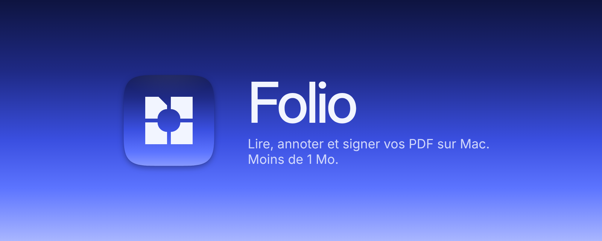

<p align="center">
  
</p>

<p align="center">
  <a href="https://github.com/yaibnmo/folio/releases/latest/download/Folio.dmg"><b>⬇︎ Télécharger Folio pour Mac (.dmg)</b></a>
  &nbsp;·&nbsp;
  <a href="https://github.com/yaibnmo/folio/releases/latest">Toutes les versions</a>
</p>

**Folio** est un lecteur et annotateur PDF pour macOS, léger et open source : l'essentiel d'Acrobat (lecture, surlignage, notes, dessin, signature, formulaires) dans une app de **moins de 1 Mo**, contre environ 2 Go pour Acrobat. Rien n'est envoyé sur Internet : tout reste sur votre Mac.

## Installation

1. Téléchargez **[Folio.dmg](https://github.com/yaibnmo/folio/releases/latest/download/Folio.dmg)**.
2. Ouvrez le fichier, puis glissez **Folio** dans le dossier **Applications**.
3. Lancez Folio depuis le Launchpad ou Spotlight (⌘ Espace, tapez « Folio »).

### Premier lancement

Folio n'est pas encore signé par Apple (la signature demande un abonnement développeur payant). macOS affiche donc un avertissement la première fois :

- **macOS 15 Sequoia et plus récent** : ouvrez Folio une première fois, fermez l'avertissement, puis allez dans **Réglages Système → Confidentialité et sécurité**, descendez jusqu'à « Folio a été bloqué » et cliquez sur **Ouvrir quand même**.
- **macOS 13 et 14** : faites un **clic droit sur Folio → Ouvrir**, puis confirmez **Ouvrir**.

Cette étape n'est à faire qu'une seule fois. Vous pouvez aussi lancer cette commande dans le Terminal :

```bash
xattr -dr com.apple.quarantine /Applications/Folio.app
```

### Ouvrir tous vos PDF avec Folio

Clic droit sur un PDF → **Lire les informations** → **Ouvrir avec : Folio** → **Tout modifier…**

## Fonctionnalités

| | |
|---|---|
| **Accueil** | Fichiers récents avec miniatures, fichiers épinglés, filtre, glisser-déposer |
| **Onglets** | Tous les PDF s'ouvrent en onglets dans une seule fenêtre, comme un navigateur : × à droite du nom pour fermer (ou clic du milieu), « + » après le dernier onglet (ou ⌘T) pour en ajouter, ⌃⇥ / ⌃⇧⇥ pour passer de l'un à l'autre |
| **Volet latéral** | Vignettes et favoris ; se réduit depuis son icône (ou ⌥⌘S), puis se rouvre d'un clic grâce au petit bouton flottant en haut à gauche du PDF ; bouton de la barre d'outils toujours visible, même en demi-écran |
| **Lecture** | Vignettes, zoom, une ou deux pages, plein écran, recherche avec compteur, aller à la page, impression |
| **Annotations** | Surligner, souligner, barrer, notes, dessin à main levée, rectangle, ellipse, flèche ; couleur et épaisseur au choix |
| **Formes** | Rectangle (coins droits ou arrondis) et ellipse : couleur, épaisseur et type de contour (continu, tirets, pointillés), fond coloré, texte à l'intérieur (double-clic), redimensionnement par les 4 coins |
| **Flèches** | Droites, coudées à 1 ou 2 angles droits, ou courbes à main levée ; épaisseur, contour, extrémités au choix à chaque bout (flèche, flèche pleine, rond, carré, losange, barre) pour les doubles flèches ; on les étire par l'une ou l'autre extrémité |
| **Zones de texte** | Tapées directement sur la page, avec une barre de mise en forme : police, taille, gras, italique, couleur, alignement, fond |
| **Clic droit** | Sur du texte : surligner (avec couleurs), souligner, barrer, note, copier. Sur une page : favori, note, texte, signer ici |
| **Signatures** | Signature manuscrite dessinée + nom en écriture cursive (6 polices), posables seules ou combinées (nom dessous ou côte à côte) |
| **Favoris** | Pages favorites par document (⌘D), listées dans la barre latérale |
| **Formulaires** | Remplissage des formulaires PDF classiques |
| **Compatibilité** | Annotations enregistrées au format PDF standard : visibles dans Acrobat, Aperçu, navigateurs… |

Un clic sur une annotation (zone de texte, signature, forme…) la sélectionne, quel que soit l'outil : on peut la déplacer, la redimensionner (poignée ronde), la modifier (double-clic), changer sa couleur ou la supprimer (⌫ ou clic droit). Tout s'annule avec ⌘Z, et rien n'est écrasé sans ⌘S.

## Raccourcis

| Action | Raccourci |
|---|---|
| Accueil | ⇧⌘H |
| Ouvrir | ⌘O |
| Nouvel onglet (ouvrir un PDF) | ⌘T |
| Enregistrer / Enregistrer sous | ⌘S / ⇧⌘S |
| Outils : sélection, surligner, souligner, barrer, note, texte, dessin, rectangle | ⌘1 … ⌘8 |
| Rechercher / suivant / précédent | ⌘F / ⌘G / ⇧⌘G |
| Page favorite | ⌘D |
| Zoom avant / arrière / taille réelle / ajuster | ⌘+ / ⌘- / ⌘0 / ⌘9 |
| Barre latérale | ⌥⌘S |
| Supprimer l'annotation sélectionnée | ⌫ |
| Revenir à l'outil Sélection | Échap |
| Flèche à 45° / carré ou cercle parfait | ⇧ pendant le tracé |

## Configuration requise

macOS 13 Ventura ou plus récent, Mac Apple Silicon ou Intel.

## Compiler depuis les sources

Il faut Xcode (ou les Command Line Tools) installé.

```bash
git clone https://github.com/yaibnmo/folio.git
cd folio
./build.sh --install          # compile et installe dans /Applications
./scripts/package.sh 1.0.0    # fabrique dist/Folio.dmg et dist/Folio.zip (app universelle)
```

Folio est écrit en Swift avec AppKit et PDFKit, les frameworks intégrés à macOS : aucune dépendance externe. Chaque version taguée (`v*`) est compilée automatiquement par GitHub Actions, qui publie le `.dmg` dans les Releases.

## Licence

[MIT](LICENSE)
